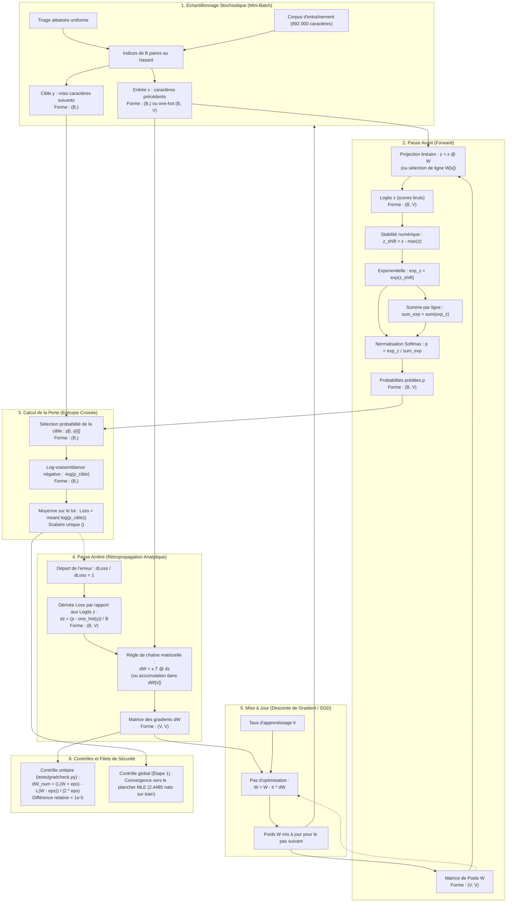

# Pipeline d'Entraînement : du Texte à la Descente de Gradient

Ce document détaille l'intégralité du pipeline d'apprentissage pour un modèle neuronal (à commencer par le bigramme de l'Étape 2, puis extensible aux étapes suivantes).

Il montre le cycle complet : échantillonnage stochastique, passe avant (*forward*), calcul de la perte, rétropropagation analytique (*backward*), et mise à jour des paramètres.

---

## 1. Vue d'Ensemble du Pipeline (Mermaid)

---

## 2. Détail des Étapes et Formes des Tenseurs

### 1. Échantillonnage stochastique
* **Source** : Le texte d'entraînement complet tokenisé sous forme d'entiers (`train_ids`).
* **Mécanisme** : Pour chaque pas, on tire un sous-ensemble aléatoire de taille `B` (ex. `B = 32`).
* **Tenseurs générés** :
  * `x` : indices des caractères précédents `# (B,)`
  * `y` : indices des caractères cibles attendus `# (B,)`
* **Rôle** : Injecter le bruit d'échantillonnage qui permet à l'optimiseur d'échapper aux mauvais minima locaux et de converger vers des minima plats.

### 2. Passe avant (*Forward*)
* **Projection linéaire** :
  * En notation vectorielle complète avec encodage one-hot : `z = x_one_hot @ W` `# (B, V)`.
  * En pratique (sans gaspiller de mémoire) : sélection directe de lignes `z = W[x]` `# (B, V)`.
* **Softmax à stabilité numérique** :
  1. `z_shift = z - np.max(z, axis=1, keepdims=True)` `# (B, V)` pour éviter l'overflow exponentiel.
  2. `exp_z = np.exp(z_shift)` `# (B, V)`.
  3. `p = exp_z / np.sum(exp_z, axis=1, keepdims=True)` `# (B, V)`.

### 3. Calcul de la perte (*Loss*)
* **Entropie croisée** :
  1. On extrait pour chaque élément du lot la probabilité qu'il a accordée à la vraie réponse : `p_cible = p[np.arange(B), y]` `# (B,)`.
  2. On calcule la surprise individuelle : `-np.log(p_cible)` `# (B,)`.
  3. On calcule la note moyenne sur le lot : `loss = np.mean(-np.log(p_cible))` (scalaire).

### 4. Passe arrière (*Backward* / Rétropropagation)
* **Pas de simulation numérique en entraînement** : calcul analytique exact et instantané.
* **Gradient par rapport aux logits `z`** :
  * `dz = p.copy()` `# (B, V)`
  * `dz[np.arange(B), y] -= 1.0` (on soustrait 1 à la vraie cible)
  * `dz /= B` (on normalise par la taille du lot car la perte est une moyenne)
* **Gradient par rapport aux poids `W`** :
  * `dW = x_one_hot.T @ dz` `# (V, V)`
  * Ou par accumulation directe : `np.add.at(dW, x, dz)` `# (V, V)`.

### 5. Mise à jour des poids (*Optimizer Step*)
* Formule : `W -= lr * dW`
* Tous les 4 225 coefficients de `W` sont ajustés simultanément dans la direction qui réduit la perte moyenne.

### 6. Filets de validation indispensables
1. **Contrôle unitaire local** ([tests/gradcheck.py](tests/gradcheck.py)) : vérifie que le gradient analytique `dW` concorde avec la dérivée par différences finies numériques à `1e-5` près.
2. **Contrôle global de convergence** : le bigramme neuronal doit converger vers le plancher statistique calculé à l'Étape 1 dans [experiments/s01-bigram-counts.md](experiments/s01-bigram-counts.md) (`train_loss ≈ 2,4485 nats`).
